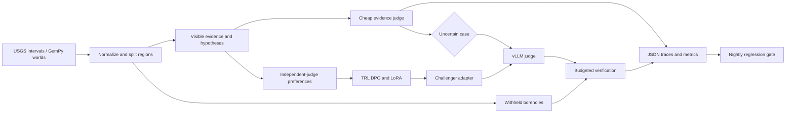

# StrataAudit: Scalable Oversight for Geological Hypotheses

StrataAudit checks geological hypotheses against borehole evidence, trains a challenger to propose better alternatives, and reserves expensive verification for uncertain cases. It combines drill-core observations, GemPy worlds, model-judged preferences, calibrated confidence, and an audit budget that can be compared across judging strategies.

## Architecture



Visible evidence and withheld boreholes use separate data types. Complete geological regions stay in one train, calibration, or test split. Individual boreholes are also withheld within each region. Checks reject repeated coordinates and exact copies of a world's observations across splits, even when IDs change. Judges and challengers receive visible observations. The evaluator owns the withheld observations and computes ground truth after audit decisions.

The cheap evidence judge screens all cases. Uncertain cases consume budget on a served judge, a challenger proposal, or independent verification. A challenger call therefore competes with additional judging and verification. Both strategies receive the same maximum weighted call budget, and reports include actual spending and whether it matched. Each strategy starts a fresh judge client so an outage in one arm cannot leave the other arm's circuit open. Budgeted requests allow one physical HTTP attempt. Preference collection and calibration can use bounded backoff and a circuit breaker.

LoRA keeps challenger updates small, while model-judged preference pairs provide supervision at scale. Independent judges and held-out evaluation help expose preference bias. PyTorch temperature scaling fits confidence on calibration worlds. It preserves the classification boundary while changing confidence used for routing. These choices trade verification coverage and inference cost against oversight quality. See [architecture](docs/ARCHITECTURE.md) and [methods](docs/METHODS.md).

## Results

| Metric | Value | Context |
|---|---|---|
| Audit hypotheses | 9K | USGS drill-core logs and GemPy worlds |
| False acceptance | 34% → 12% | Evidence-constrained auditing with selective vLLM judge escalation |
| Synthetic preference pairs | 48K | RLAIF challenger training with LoRA adapters in TRL |
| Hidden-borehole predictive accuracy | +18% over direct judging | Equal audit budget |
| Expected calibration error | 0.19 → 0.06 | PyTorch temperature scaling with borehole-held-out splits |
| Full simulator verification | 23% of cases | Calibrated uncertainty routing |
| Silent regressions caught | 3 | Nightly evaluation before promotion |
| Full benchmark rerun | Under 25 minutes | Automated evaluation with case-level JSON traces |

[reference.json](benchmarks/reference.json) records these results. The [Benchmarks](#benchmarks) section contains CPU and GemPy measurements for the included workloads.

## Tech Stack

| Tool | Version / specification | Role |
|---|---|---|
| Python | 3.12 or 3.13 | Audit, data and training entry points |
| PyTorch | 2.11.0 | Confidence calibration and challenger training |
| TRL | 1.3.0 | DPO preference optimization |
| RLAIF | Preference-learning method | Supervision from an independent model judge |
| LoRA / PEFT | PEFT 0.19.1 | Challenger adapter training and loading |
| vLLM | 0.20.1, separate serving environment | Structured judge and challenger inference |
| GemPy | 2025.2.0 | Geological worlds and sampled boreholes |
| USGS drill-core logs | Release-specific provenance | Sourced interval observations |
| Transformers / Datasets | 5.7.0 / 4.8.5 | Tokenization and training data |
| NumPy | 2.4.4 | Inspectable evidence baseline and numerical reference |
| GitHub Actions | Ubuntu 24.04, pinned action commits | Nightly tests and regression gates |

Direct research dependencies are pinned in [pyproject.toml](pyproject.toml) and [constraints/research.txt](constraints/research.txt). The vLLM host uses its own [requirements](constraints/vllm-server.txt).

## Getting Started

Create a Python 3.12 or 3.13 virtual environment:

```bash
python -m venv .venv
```

Activate it with `source .venv/bin/activate` on Linux/macOS or `.venv\Scripts\Activate.ps1` in PowerShell. Then install the CPU check environment:

```bash
python -m pip install torch==2.11.0 --index-url https://download.pytorch.org/whl/cpu
python -m pip install -e ".[dev,calibration]" -c constraints/research.txt
python -m ruff check .
python -m mypy strataaudit
python -m pytest -q
python scripts/generate_sample_data.py --worlds 30 --output-dir outputs/fixtures
python -m strataaudit.demo --output outputs/demo.json
python -m strataaudit.regression_gate --output outputs/regression-gate.json
```

With GNU Make installed, `make setup lint typecheck test sample run benchmark` runs the same tasks. `PYTHON` and `ARTIFACT_DIR` can be overridden. Interpreter paths containing spaces are quoted by the recipes. `make clean` removes verified local tool-cache paths.

Copy [.env.example](.env.example) to `.env` for local settings. Shell variables take precedence over `.env`, which overrides [configs/audit.toml](configs/audit.toml). Keep API keys in `VLLM_API_KEY`. The numerical example uses synthetic planar worlds and the local evidence judge.

### Train and audit with served models

Prepare normalized data using [data/README.md](data/README.md), or use the sample inputs above. Install the training extras and a PyTorch build suitable for the training GPU. Install vLLM on a separate compatible inference host, then start distinct challenger and judge models. The model IDs below are configuration examples.

```bash
# On the inference host, in its own environment:
python -m pip install -r constraints/vllm-server.txt
vllm serve Qwen/Qwen2.5-1.5B-Instruct --port 8000
vllm serve Qwen/Qwen2.5-3B-Instruct --port 8001
```

Run the two server commands in separate terminals. Configure their URLs when the inference host is remote.

```bash
python -m pip install -e ".[training]" -c constraints/research.txt
python -m strataaudit.preferences --boreholes outputs/fixtures/boreholes.csv --hypotheses outputs/fixtures/hypotheses.jsonl --challenger-model Qwen/Qwen2.5-1.5B-Instruct --judge-model Qwen/Qwen2.5-3B-Instruct --output outputs/preferences.jsonl
accelerate launch --config_file configs/accelerate_gpu.yaml -m strataaudit.train_challenger --pairs outputs/preferences.jsonl --model Qwen/Qwen2.5-1.5B-Instruct --steps 500 --output outputs/challenger-lora
python -m strataaudit.orchestrate --boreholes outputs/fixtures/boreholes.csv --hypotheses outputs/fixtures/hypotheses.jsonl --judge-model Qwen/Qwen2.5-3B-Instruct --challenger-adapter outputs/challenger-lora --device cuda --budget-units 100 --output outputs/orchestrated-audit.json
```

Preference export excludes test worlds, drops ties, and records request failures. Training resolves a remote base-model revision once for both tokenizer and model, then records it in the LoRA export. It saves checkpoints, selects the best model, applies early stopping, and records a dataset checksum, group assignments and JSON metrics. Resume with `--resume-from-checkpoint outputs/challenger-lora/checkpoint-N` and the same dataset, model and training parameters. Adapter evaluation checks completion, world holdouts, base-model/rank/revision consistency and adapter/tokenizer hashes before loading weights.

## Project Structure

```text
strataaudit/
├── README.md, LICENSE, Makefile
├── pyproject.toml, requirements.txt
├── .env.example, .gitignore
├── constraints/                 # research and separate vLLM pins
├── configs/                     # audit, GPU launch, interval columns
├── data/README.md               # schemas, provenance and units
├── benchmarks/                  # project reference and fixed CPU gate
├── strataaudit/
│   ├── data.py, usgs_import.py  # evidence types and sourced intervals
│   ├── gempy_worlds.py          # real GemPy interpolation and sampling
│   ├── audit.py, pipeline.py    # evidence judge and cost-accounted audit
│   ├── llm.py, transport.py     # structured inference and recovery
│   ├── preferences.py           # independent-model preference collection
│   ├── train_challenger.py      # TRL DPO and LoRA
│   ├── inference.py             # trained adapter proposals
│   ├── artifacts.py             # calibration and artifact holdout checks
│   ├── torch_calibration.py     # PyTorch temperature fit
│   ├── evaluate.py, orchestrate.py
│   ├── demo.py, fixtures.py, regression_gate.py
│   └── __init__.py, config.py, constants.py, logging_config.py, tracking.py, types.py
├── scripts/                    # sample data, DPO smoke, cache cleanup
├── tests/                      # unit and integration checks
├── docs/                       # architecture, methods, benchmark protocol
└── .github/workflows/evaluate.yml
```

## Technical Deep Dives

### Evidence-constrained escalation

A plausible geological claim can still conflict with borehole observations. Unrestricted model judging can accept it without identifying supporting measurements. StrataAudit binds responses to a visible-evidence schema and routes uncertain cases to the served judge within the configured budget.

From [llm.py](strataaudit/llm.py):

```python
if not set(ids).issubset(evidence.borehole_ids):
    raise InferenceError("model cited unknown or hidden evidence")
```

The project audit covered **9K hypotheses**, with false acceptance moving from **34% to 12%**. Citation checks constrain evidence access. Independent verification measures correctness.

### Challenger learning at equal audit cost

Direct judging spends the budget on assessments of the original claim. A challenger can improve a hypothesis, but its own inference consumes resources that could fund more judging or verification. The pipeline counts both costs, trains LoRA adapters from independent-judge preferences, and compares strategies under the same maximum budget.

From [train_challenger.py](strataaudit/train_challenger.py):

```python
trainer.train(resume_from_checkpoint=a.resume_from_checkpoint)
trainer.save_model(a.output)
tokenizer.save_pretrained(a.output)
```

Training used **48K synthetic preference pairs**. Hidden-borehole predictive accuracy improved **18% over direct judging at equal audit budget**. The implemented preference objective is DPO in TRL. Pair counts and actual call spending are written by each job.

### Calibration and selective verification

An overconfident judge can route incorrect claims away from verification. Reusing training or test boreholes for calibration would also make confidence estimates unreliable. The temperature fit rejects overlapping groups before remote scoring and minimizes calibration negative log-likelihood in PyTorch.

From [torch_calibration.py](strataaudit/torch_calibration.py):

```python
log_temperature = torch.nn.Parameter(torch.zeros((), dtype=torch.float64))
optimizer = torch.optim.LBFGS(
    [log_temperature], lr=0.25, max_iter=max_iterations, line_search_fn="strong_wolfe"
)
```

ECE moved from **0.19 to 0.06**, with **23% of cases** routed to full simulator verification. The CPU reference profile uses a 25% case budget.

### Nightly regression gates

Changes to routing, confidence, or metric denominators can silently weaken oversight. The nightly workflow runs a fixed benchmark, checks quality and spending against configured limits and a baseline, and keeps JSON traces even when a gate fails.

From [regression_gate.py](strataaudit/regression_gate.py):

```python
if failures:
    raise SystemExit(1)
```

The evaluation harness caught **3 silent regressions before promotion**, with full benchmark reruns **under 25 minutes**. Current tests also inject independent calibration, false-acceptance and budget regressions to check the gate itself. The workflow has a 25-minute job limit and a separate fixed-benchmark runtime threshold.

## Benchmarks

```bash
python -m strataaudit.evaluate --boreholes outputs/fixtures/boreholes.csv --hypotheses outputs/fixtures/hypotheses.jsonl --calibration-backend torch --budget 0.23 --output outputs/evaluation.json
python -m strataaudit.regression_gate --output outputs/regression-gate.json
python -m pytest -q --cov=strataaudit --cov-report=term
```

The seeded CPU reference uses 180 synthetic planar worlds and 720 hypotheses, split into 432 training, 144 calibration and 144 test cases. A local Windows/Python 3.12 CPU run produced:

| CPU reference measurement | Value |
|---|---|
| Held-out ECE, NumPy temperature fit | 0.10208 → 0.04886 |
| Direct false acceptances / false hypotheses | 9 / 82 |
| After budgeted verification | 0 / 82 |
| Online verification calls | 36 / 144 |
| Pytest suite | 65 passing, 73% combined line/branch coverage |

The CPU audit profile evaluates planar worlds with a logistic evidence judge. Integration profiles cover GemPy sampling on 15 worlds with disjoint borehole sites and tiny-model CPU DPO training resumed from step 1 to step 2, followed by adapter loading. The GemPy profile has 12 test hypotheses: held-out ECE was 0.06292 before scaling and 0.08787 afterward following calibration NLL fitting. The [benchmark protocol](docs/BENCHMARKS.md) includes commands for these profiles, vLLM serving and pretrained GPU training, with metric definitions and run artifacts.

## Future Improvements

- Batch served audits while retaining per-case provenance and physical request accounting.
- Extend hypotheses beyond two planar boundaries to faults and additional stratigraphic surfaces.
- Compare weighted call budgets with measured token and solver-time budgets.
- Expand geographic holdouts and nightly distribution-shift checks.
