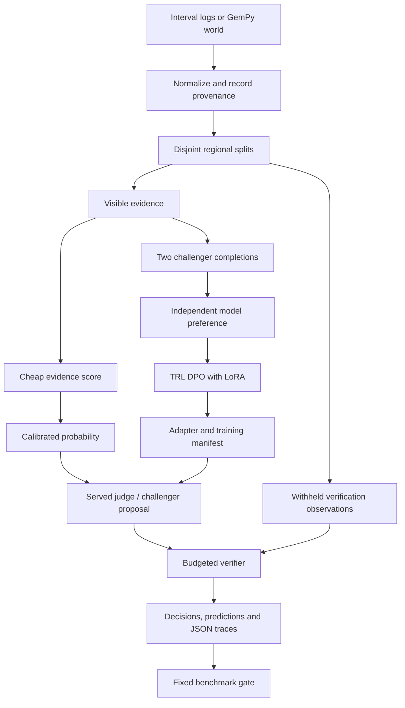

# Architecture

StrataAudit has training and audit paths. They share evidence schemas, but only
the evaluator and verifier can access withheld boreholes.

## Responsibilities

| Component | Responsibility |
|---|---|
| `data.py` | Validate finite boundary data, identifiers, observation roles and group splits |
| `usgs_import.py` | Convert source intervals to boundary observations and retain provenance |
| `gempy_worlds.py` | Construct GemPy surfaces and sample borehole transitions |
| `audit.py` | Fit the numerical evidence judge, compute metrics and verify withheld error |
| `llm.py` | Build evidence-limited prompts and validate outputs and citations |
| `transport.py` | Bound timeouts, backoff, circuit state and physical request attempts |
| `preferences.py` | Collect independent-model preferences excluding test worlds |
| `train_challenger.py` | Train/resume adapters and retain group/checkpoint metadata |
| `artifacts.py` | Check adapter holdouts and fit served-judge temperature |
| `pipeline.py` | Account for expensive calls and compare audit strategies |
| `orchestrate.py` | Wire adapters, served judging, calibration and reports |
| `regression_gate.py` | Enforce quality, spending, case-count, runtime and drift limits |

## Data boundaries

`Evidence` contains visible boreholes. `Verification` contains separate samples.
`Hypothesis` identifies a world and carries four boundary-model parameters.
`Case` joins them for offline fitting/evaluation. Model prompts are constructed
from `Evidence` and `Hypothesis`, never an entire `Case`.

The numerical judge uses training-world labels. Temperature fitting uses
calibration-world labels. Complete regions remain disjoint across training,
calibration and test. Boreholes also remain disjoint between visible and
verification roles within a region, with unique transect coordinates in each
role. Whole-world observation copies are checked independently of IDs and row
order across splits. Exact content identity catches copied inputs. Geographic
groups are defined by the source's region/site assignments. Served calibration
checks these groups before remote scoring.

Adapter evaluation checks `training_manifest.json` before loading weights.
A world used for adapter training/calibration cannot enter the test split.
Shared worlds must retain their split assignments. Reports include the checked
manifest hash and exported adapter/tokenizer hashes, associating the checkpoint
with its audit. Incomplete runs and base-model/rank/revision mismatches are refused. Evaluation
reports retain input-file checksums and world/split assignments.

## Training path

The challenger produces two evidence-grounded alternatives. A distinct model
judge ranks them from the same visible observations. Ties and identical
completions are dropped. Invalid requests are recorded separately. A completed
pair file replaces its partial file atomically.

TRL DPO trains chosen/rejected conversations using PEFT LoRA adapters. Validation
loss selects the saved best model. Early stopping, optimizer checkpoints,
dataset hashing and JSON metrics support interrupted jobs and run comparisons.
Resume checks the original model, preference-file checksum and training
parameters before restoring a checkpoint. The final manifest hashes exported
weights and PEFT configuration.
For a remote base model, training resolves its revision before tokenizer/model
loading and retains that revision in PEFT metadata for later inference.

Model preferences provide scale but can inherit judge bias. Evaluation uses
withheld geological observations independently of that preference judge.
LoRA limits trainable parameters. The selected base model still determines
most memory and inference requirements.

## Audit budget and decisions

Both strategies begin with the same evidence judge and calibrated probabilities.
Direct judging assesses uncertain original hypotheses. Challenger-assisted
auditing spends additional units on an alternative and its judge assessment.
A supported alternative can replace the original predictive model.

Every attempted expensive operation consumes its configured integer cost,
including failed requests. A shared maximum budget and verification reserve
keep strategies comparable. These accounting weights control the audit budget.
Record GPU time, token counts and monetary cost separately when comparing hosts.
Actual spending may differ below the shared cap and is compared explicitly.
Each arm constructs a fresh judge client using the same frozen calibration.
Circuit state from a direct-judging outage cannot suppress the assisted arm.

Budgeted model calls permit one physical HTTP attempt, preventing hidden retry
spending. Unbudgeted pair collection and calibration retain bounded exponential
retries. Offline oracle labels are computed after decisions and counted
separately from online verification.

Full verification compares proposed boundaries with complete withheld borehole
samples. GemPy supplies samples through interpolation, and the numerical
reference uses analytic planar worlds. The hypothesis adapter represents two
planar boundaries. Online verification reads the precomputed samples. Each
comparison increments its call count and consumes the configured verification weight.

## Failure behavior

| Failure | Behavior |
|---|---|
| Wrong dimensions, nonfinite values or duplicate IDs | Reject input before fitting/auditing |
| Shared training/test region or reused borehole ID | Reject the split |
| Malformed, truncated or uncited model response | Record failure and retain the available evidence decision |
| Transient transport outage | Bounded backoff outside audited call budgets |
| Repeated transport outage | Open the circuit until its configured reset interval |
| Challenger/judge failure during audit | Charge the attempt and retain remaining verification budget |
| Inconsistent checkpoint provenance | Refuse evaluation or resume |
| Quality or spending regression | Write traces/report and exit unsuccessfully |

Logs contain timestamps, levels and trace IDs. Case traces retain model events,
decisions, call counts and evaluator-only truth. Credentials and request headers
are excluded from logs.

## Scaling considerations

Preference collection currently makes sequential model calls. Batching can
reduce overhead, but must retain per-case citations, physical-call accounting
and failure records. Full data generation and model serving run on the selected
research hosts. The nightly CPU job checks a fixed numerical set.

The preference loader reads records into memory before creating a Datasets
table. Larger collections may need shards. World IDs and split metadata must
remain available when streaming or sharding is introduced.

More verification spends additional solver/oracle budget. More challenger use
leaves fewer units for judging. Temperature scaling changes confidence. It
preserves logit signs and the evidence used for each decision.
